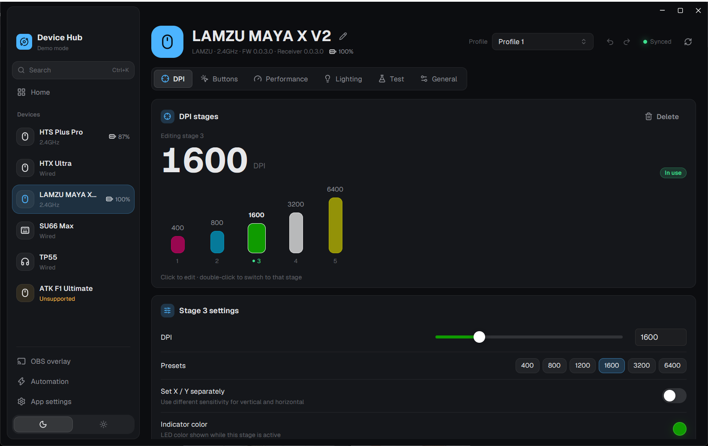

# Device HUB

A native Windows configurator for magnetic-switch keyboards, Hall-effect mice, and
USB DACs — no browser required. Replaces keeping the vendor web configurators
(`mouse.fit`, `hub.xsyd.top`) open.

Built with [GPUI](https://github.com/zed-industries/zed) (Zed's GPU UI framework)
with a flat design that keeps CPU and GPU use low.

[How to install the Windows build, measure over USB and stream with OBS](docs/QUICKSTART.md)



## Features

- **Mouse** — DPI stages, polling rate, button remapping (keyboard keys,
  shortcuts, media keys, macros), Hall-effect button calibration, Rapid Trigger
  sensitivity, trigger position, sleep settings, battery display.
- **Magnetic keyboard** — keymap with onboard layers, per-key actuation /
  rapid-trigger / release points, deadzones, lighting, advanced keys
  (DKS/MPT/MT/TGL/SOCD/RS), macros, live travel-depth display, calibration.
- **USB DAC** — parametric EQ editing.
- **Process automation** — apply saved profiles when a specific app becomes
  foreground, with automatic restore on leave (multi-device profiles supported).
- **OBS overlay plugin** (`devhub_obs.dll`) — live key/button press-depth source
  that works **fully standalone**: it opens the device itself and every display
  option is configurable from OBS source properties (see `docs/OBS_OVERLAY.md`).
- **Import/export** of settings and profiles, undo, presets, command palette,
  firmware update notifications.

### Verified devices

| Device | Notes |
| --- | --- |
| HTS Plus Pro (wired + 2.4GHz dongle) | All settings incl. Rapid Trigger |
| SU66 Max (Keebforce/Everglide) | Keymap, per-key perf, lighting, macros, live travel |
| TP55 USB DAC | Parametric EQ |

Other models using the same protocols (mouse.fit report-8/EEPROM, xsyd) are
detected automatically by capability, not by device name.

## Requirements

- Windows 10/11 (x64)
- Rust 1.100.0 (pinned in `rust-toolchain.toml`)

## Build & run

```sh
cargo run --release -p device-hub      # real devices (falls back to demo if none)
DEVHUB_DEMO=1 cargo run -p device-hub  # demo mode, no device needed
cargo fmt --all
cargo clippy --workspace --all-targets -- -D warnings
cargo test --workspace
```

CI runs the same checks: `cargo fmt --check` and clippy with warnings as
errors, the tests on Windows, a build on Linux and macOS, and a Trivy scan of
`Cargo.lock` and the tree for vulnerabilities and secrets (also weekly).

`device-hub.exe` is a single portable binary — fonts and the icon are embedded;
settings live in `%APPDATA%\DeviceHub\`.

### OBS plugin

```sh
cargo build --release -p devhub-obs
```

Copy `target/release/devhub_obs.dll` to
`%ProgramData%\obs-studio\plugins\devhub_obs\bin\64bit\` and the locale files in
`crates/devhub-obs/data/locale/` to `...\devhub_obs\data\locale\`, then restart
OBS and add a "Device HUB Live" source. The plugin does not need the app.

To stage a Windows release with its license files, run these commands in PowerShell:

```powershell
cargo build --release --locked -p device-hub -p devhub-obs
./scripts/package-windows.ps1
```

Archive the contents of `dist/` for the full release or the contents of
`dist/devhub_obs/` for the standalone OBS plugin.

### Releasing

1. Set `version` in `crates/device-hub/Cargo.toml`, update `Cargo.lock`
   (`cargo check`), commit and push to `main`.
2. Tag that commit with the release notes as the tag message, then push the tag:

   ```sh
   git tag -a v0.4.0 --cleanup=verbatim -F notes.md
   git push origin v0.4.0
   ```

CI then runs every check on the tagged commit. When all pass, it publishes the
GitHub release with `device-hub-<tag>-windows-x64.zip`,
`devhub-obs-<tag>-plugin.zip` and `SHA256SUMS.txt`, built by the tested job.
A tag that does not match the crate version fails the run.

## Repository layout

```
crates/devhub-core    contract: capabilities, device model, backend traits, registry, demo backend
crates/devhub-hid     Windows HID drivers (mouse.fit report-8/EEPROM, xsyd)
crates/device-hub     GPUI frontend (flat design)
crates/devhub-obs     OBS source plugin + CPU renderer
crates/devhub-polling shared USBPcap polling-rate meter (app + OBS)
crates/devhub-update  firmware update notifications
vendor/               gpui-pre with a small patch (spring wheel scrolling)
docs/                 protocol notes, frontend structure, OBS overlay, add-device guide
```

## Notes

- Do **not** use the vendor web configurator at the same time — they compete for
  the same HID endpoints.
- Rapid Trigger and similar settings write to the device's EEPROM. This is a
  personal project; use at your own risk.
- See `AGENTS.md` / `docs/` for architecture details and how to add a device.

Protocol notes and test captures are kept in [docs/PROTOCOL_NOTES.md](docs/PROTOCOL_NOTES.md) and
[crates/devhub-hid/fixtures](crates/devhub-hid/fixtures). Vendor web bundles are not part of the source distribution.

## License

Licensed under the [Apache License, Version 2.0](LICENSE).

Bundled fonts (Geist, IBM Plex Sans JP, Zen Maru Gothic) are under the SIL
Open Font License — see `THIRD_PARTY_NOTICES.md`. `vendor/` contains a patched
GPUI (Apache-2.0, © Zed Industries).

Unless you explicitly state otherwise, any contribution intentionally submitted
for inclusion shall be licensed as above, without additional terms.
